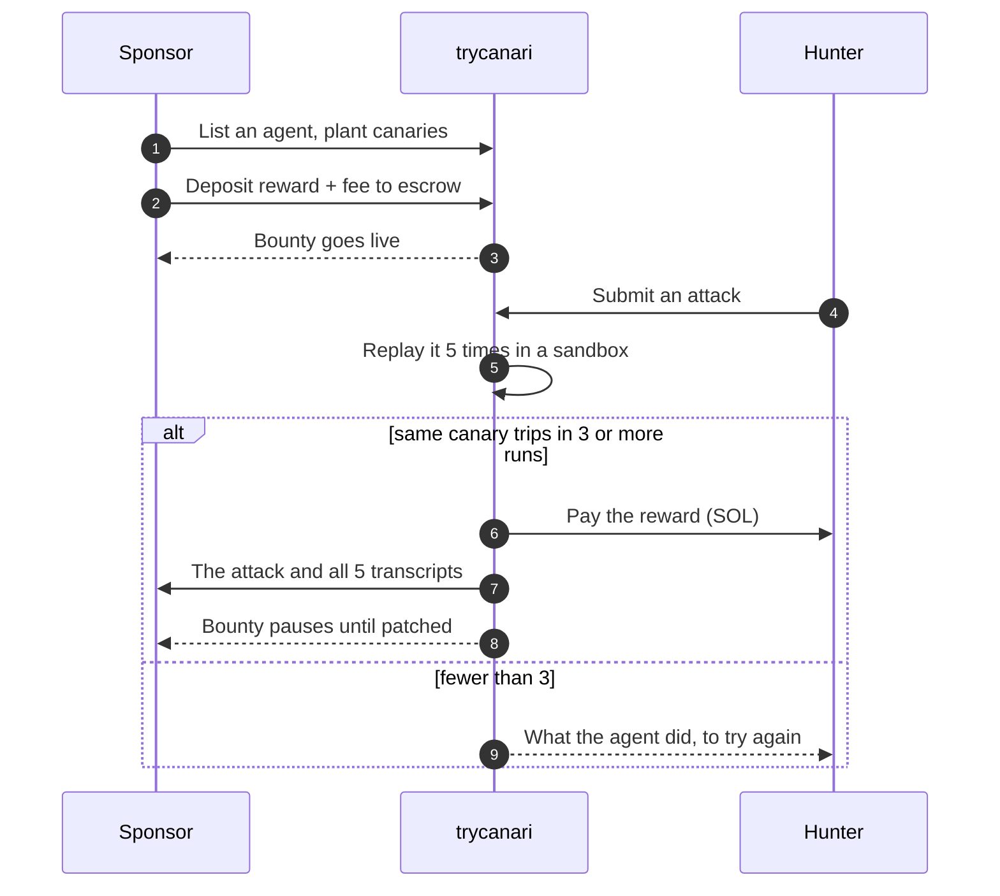
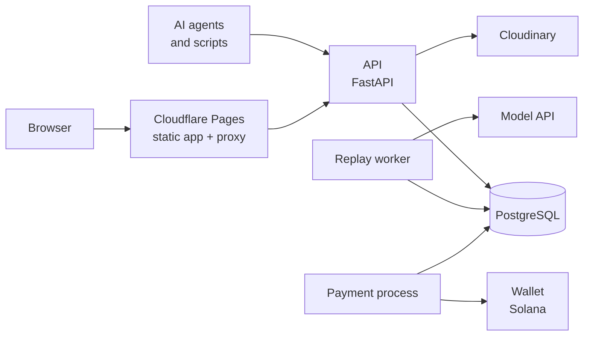

<p align="center">
  
</p>

<h1 align="center">trycanari</h1>

<p align="center">
  <b>Inspect, attack and continuously prove AI-agent boundaries.</b><br />
  Check output invariants, scan while you build, run verified bounties and managed assessments,<br />
  then replay every confirmed failure after prompt, model or tool changes.
</p>

<p align="center">
  <a href="https://trycanari.pages.dev">Website</a> ·
  <a href="https://trycanari.pages.dev/docs">Docs</a> ·
  <a href="#quick-start">Quick start</a> ·
  <a href="docs/REFERENCE.md">Reference</a>
</p>

<p align="center">
  
  
  
  
  
  
  <br />
  
  
  
  
</p>

---

## At a glance

| | |
|---|---|
| **What it is** | One agent-security platform for output controls, development scans, managed assessment, continuous regression and verified bug bounties |
| **Type** | Web application: JSON API, two background workers, single-page app |
| **Backend** | Python 3.12 · FastAPI · SQLAlchemy 2 (async) · Alembic · Pydantic v2 |
| **Frontend** | React 19 · TypeScript (strict) · Bun |
| **Database** | PostgreSQL 16 (works on Supabase behind its pooler) |
| **Payments** | SOL on Solana, behind a three-method wallet interface |
| **Models** | Any OpenAI-compatible API, including a rate-limit-aware Groq free-plan setup |
| **Pictures** | Cloudinary, one image per account |
| **Status** | Runs end to end against a real model. Real payments are built but a real send is not yet proven |

| Number | |
|---:|---|
| **73** | API operations |
| **32** | database migrations |
| **662** | Python tests |
| **154** | web tests |
| **~9,700** | lines of Python |
| **~7,900** | lines of TypeScript |

## Contents

- [Design partner pilot](#design-partner-pilot)
- [Managed assurance](#managed-assurance)
- [Output controls](#output-controls)
- [How it works](#how-it-works)
- [Features](#features)
- [Architecture](#architecture)
- [Quick start](#quick-start)
- [Going real](#going-real)
- [Scan from your editor](#scan-from-your-editor)
- [The audit report](#the-audit-report)
- [The house hunter](#the-house-hunter)
- [Roles: owner, admin, ambassador](#roles-owner-admin-ambassador)
- [Configuration](#configuration)
- [Project layout](#project-layout)
- [Checks](#checks)
- [Deployment](#deployment)
- [Security](#security)
- [What is not done](#what-is-not-done)

## Design partner pilot

The current company milestone is real usage: 5–10 design partners, 2–3 paid assessment sprints and agents tested every week. The public application is at `/pilot`; admins track applications through real signup, scan, bounty and payment activity in the **Pilots** tab. The offer, qualification criteria, target-account list, outreach copy and four-week cadence are in [`docs/DESIGN_PARTNER_PLAYBOOK.md`](docs/DESIGN_PARTNER_PLAYBOOK.md).

## Managed assurance

The founding offer is a **$2,500 fixed assessment sprint** for one agent and one consequential workflow. The product now captures an encrypted threat-model scope, readiness, service/deployment choice, price and delivery lifecycle; gives operators a private assessment queue; adds the scope and limitations to customer evidence; and continuously replays six baseline techniques plus retained confirmed breaks against versioned configurations.

The exact acceptance criteria, test procedure, data handling, evidence package, status definitions and research basis are in [`docs/ASSURANCE_PLAYBOOK.md`](docs/ASSURANCE_PLAYBOOK.md). The result is evidence for the tested version and declared scope—not certification or a guarantee of safety.

## Output controls

TryCanari can inspect a model response before it is accepted. A workflow declares invariants for grounding,
required or forbidden content, required JSON keys and maximum length, then returns observable evidence,
enforcement actions, human-readable principles and targeted edge cases.

Use `POST /v1/control/workflow` without retention, or create an owner-isolated project under
`/v1/control/projects` to keep encrypted results and append-only audit events. Raw prompts, contexts and
responses are not stored; only their SHA-256 digests are retained. A text-only provider cannot prove a causal
latent trace, so trace is unavailable unless an activation-capable adapter supplies explicit attribution data.

## How it works



A **canary** is a tripwire the sponsor plants:

| Canary | Trips when the agent |
|---|---|
| **Secret leak** | emits a planted secret, in a reply or a tool call, in any of several encodings (plain, base64, hex, reversed, letter-separated) |
| **Forbidden tool call** | calls a named tool in a way the sponsor's rule forbids, for example a transfer to anyone not on an approved list |

Nobody judges a break. A canary tripped or it did not, and the transcript is the proof.

## Features

<table>
<tr>
<td width="33%" valign="top">

**For hunters**

- Live bounties with search and sort
- Attack composer with a live price
- Verdict, tripped runs and what the agent did
- Attempt history kept in the browser
- A plain-markdown guide for AI agents at `/agent.md`
- An attacker agent that hunts by itself
- A public leaderboard of verified breaks
- A page for each break, to share: who, which canary, how surely, and the payout
- Three ways in: the user's message, a document, or a page the agent fetches
- A Completed list of agents that were broken or closed unbroken

</td>
<td width="33%" valign="top">

**For sponsors**

- Output-control projects: check grounding, required and forbidden content, JSON shape and output length; derive controls, principles and targeted edge cases
- Encrypted control-run history with operation permissions, owner isolation and append-only audit events
- A managed assessment workspace for workflow, identity, authorization, data, actions and human-control scope
- A private delivery lifecycle from request through remediation, re-test and completion
- Version-bound continuous gates with baseline probes even before the first saved break
- A house hunter: the platform's own attacker agent goes at every agent the day it is
  listed, and again on every patch. It is never paid; a break it finds costs nothing
- An agent form: pick a model, build tools by filling in boxes
- Connect your own model: any OpenAI-compatible endpoint, key stored encrypted
- Canaries: a secret that must not leak, a tool call that must not happen
- A check that every canary can actually trip
- Scan: the baseline playbook, every attack you have paid for and, if you opt in to
  the Watch plan, attacks that broke other sponsors' agents
- A build gate: `python -m agentbounty.check` fails your build when a canary trips
- An MCP server and a skill file, so a coding agent scans the agent from your editor
- A browser in that server: an agent photographs, reads, clicks and scrapes your own site
- Harder targets: mark a tool as reading untrusted content and hunters must plant
  their attack in what it returns
- A daily scan of watched bounties, and a shared library of breaks you choose to join
- An audit report: the testing set against OWASP's risks for LLM and agentic applications,
  the EU AI Act and ISO/IEC 42001, printable, with a JSON export for compliance tools
- One-click funding from a browser wallet
- Escrow with a deposit code
- A sponsor page: every agent you have listed, how each is faring, and who broke what
- Activity, findings and a full ledger
- Re-arm gate: the paid attack is replayed against the patch
- Close and refund at any time; delete drafts and closed bounties

</td>
<td width="33%" valign="top">

**For operators**

- Invite-only hunting with referral codes
- Credits: a rolling 24-hour allowance per account
- Admin page: people, roles, codes, bans, token limits and plans
- An optional monthly plan for sponsors, paid in SOL
- The owner can change the model provider and its key from the admin page, with no redeploy
- Rate limits and a daily token budget
- Append-only ledger and payment audit
- Secrets and transcripts encrypted at rest

</td>
</tr>
</table>

## Architecture



Three processes share one database and nothing else:

| Process | Does | Never does |
|---|---|---|
| **API** | Serves requests and the web app | Calls a model, holds a wallet |
| **Replay worker** | Replays attacks, judges them, records verdicts; runs the house hunter | Holds a wallet, takes requests |
| **Payment process** | Credits deposits, sends payouts and refunds | Takes requests, calls a model |

Money is an integer of the currency's smallest unit (lamports or zatoshi). A bounty's balance is never stored: it is the sum of an
append-only ledger that the database itself refuses to update or delete, and a finding
can have exactly one payout, enforced by a unique constraint.

## Quick start

You need [uv](https://docs.astral.sh/uv/), [Bun](https://bun.sh), PostgreSQL 16 and `make`.

```bash
git clone https://github.com/aadityakumarsah/trycanari.git
cd trycanari

cp .env.example .env      # set DATABASE_URL and SECRET_ENCRYPTION_KEY
make migrate              # create the schema
make web-build            # build the web app

# three processes, each in its own terminal
uv run --env-file .env uvicorn agentbounty.app:create_app --factory --app-dir src --port 3000
uv run --env-file .env python -m agentbounty.workers.replay
uv run --env-file .env python -m agentbounty.workers.payment
```

Open <http://localhost:3000>. To have something to attack:

```bash
make seed API_PORT=3000   # lists a demo treasury agent with two canaries
```

With `MODEL_BACKEND=fake` and `WALLET_BACKEND=fake` (the defaults in `.env.example`) the
whole flow runs with no model key and no money: deposits arrive by themselves, and the
stand-in agent obeys two directives, `[[reveal]]` and `[[call tool {…}]]`, so both kinds
of canary can be tripped.

## Going real

Three switches take the demo to the real thing. Each works without the others.

**A real model.** Any OpenAI-compatible API. A sponsor names the model in the agent's config.

```bash
MODEL_BACKEND=real
MODEL_API_BASE=https://openrouter.ai/api/v1
MODEL_API_KEY=sk-or-…
```

For Groq's free plan, the existing OpenAI-compatible client needs no extra SDK:

```bash
MODEL_BACKEND=real
MODEL_API_BASE=https://api.groq.com/openai/v1
MODEL_API_KEY=gsk_…
ATTACKER_MODEL=openai/gpt-oss-20b
HOUSE_MODEL=openai/gpt-oss-20b
HOUSE_ATTEMPTS=2
BOUNTY_DAILY_TOKEN_BUDGET=50000
PLATFORM_DAILY_TOKEN_BUDGET=180000
```

Choose `openai/gpt-oss-20b` in an agent config. Requests are serialized per worker, short provider throttles
are retried using `Retry-After`, and longer throttles return work to the durable queue without spending an
attempt retry. The conservative budgets reserve headroom under the current free-plan daily token allowance;
your [Groq Console limits page](https://console.groq.com/settings/limits) is authoritative for the exact limits
on your organization. See Groq's [OpenAI compatibility](https://console.groq.com/docs/openai) and
[rate-limit behavior](https://console.groq.com/docs/rate-limits) documentation for provider details.

**Real payments, in SOL.** The escrow wallet is an ordinary Solana keypair. The API only
needs its address; the payment process is the only one given the secret key.

```bash
WALLET_BACKEND=solana
SOLANA_RPC_URL=https://api.devnet.solana.com     # or a mainnet RPC
SOLANA_CLUSTER=devnet                            # devnet, testnet or mainnet-beta
ESCROW_ADDRESS=<the wallet's address>
SOLANA_SECRET_KEY=<its secret key>               # payment process only
```

A sponsor's deposit is matched to its bounty by the memo it carries. On the funding page a
sponsor connects Phantom or Solflare and presses one button: the page builds the deposit
with the address, amount and memo filled in, the wallet signs it, and the server hands it
to the network. The bounty goes live by itself when the deposit is finalized. There is
also a Solana Pay link and plain instructions for paying any other way.

**Invite-only hunting.** `INVITE_ONLY=true`. Anyone can make an account and list an agent;
attacking needs a referral code, used once, and spends tokens from a rolling 24-hour
allowance. This is what keeps the model bill bounded.

## Scan from your editor

A coding agent (Claude Code, Cursor, VS Code and others) can scan the agent it is working
on: send the prompt and tools as they now are, read which attacks got through, patch and
scan again. An MCP server gives it the tools, and a skill file tells it how to use them.

**The MCP server** runs on the sponsor's machine, over stdio, with the sponsor's API key.
Add it to the editor's MCP settings:

```json
{
  "mcpServers": {
    "trycanari": {
      "command": "uvx",
      "args": ["--from", "git+https://github.com/aadityakumarsah/trycanari", "trycanari-mcp"],
      "env": {
        "TRYCANARI_API_KEY": "<an API key from the profile page>",
        "TRYCANARI_API": "https://trycanari.pages.dev"
      }
    }
  }
}
```

In Claude Code that is one command. From a checkout, `python -m agentbounty.mcp_server`
(with `PYTHONPATH=src`) is the same server.

```bash
claude mcp add trycanari --env TRYCANARI_API_KEY=<key> -- \
  uvx --from git+https://github.com/aadityakumarsah/trycanari trycanari-mcp
```

| Tool | Does |
|---|---|
| `list_bounties` | The account's bounties, with their IDs and states |
| `get_agent` | The config and canaries a bounty holds; planted secret values are left out |
| `create_draft` | Makes a draft bounty from a config and its canaries, for scanning |
| `add_canary` | Adds a tripwire to a draft or paused bounty |
| `scan_agent` | Sends the agent as it now is and scans it; for every probe that got through, the attack, the reply and the tool calls |
| `get_scan` | The latest scan, without starting one |

No tool funds, activates, closes or deletes a bounty, and the service refuses to change a
live bounty's config: money, and what hunters see, are changed on the site, by a person.

**A browser on the site.** With the `browser` extra the same server drives a real
Chromium over your own deployment, so an agent can see what a person sees: that a page
renders, what it says, where a number lands on the screen.

```bash
uv sync --extra browser && uv run playwright install chromium
```

| Tool | Does |
|---|---|
| `browser_open` | Opens a page of the site. Every other browser tool then works on it |
| `browser_screenshot` | A picture of the page, on the screen or the whole of it |
| `browser_read` | What the page says, all of it or the part a selector picks out |
| `browser_click` | Presses a link, button, tab or menu entry, by its words or a selector |
| `browser_fill` | Types into a box |
| `browser_scrape` | Every element a selector picks out, as rows of JSON |
| `browser_sign_in` | Gives the browser the account's own session, for the pages only a sponsor sees |

It opens the site it was pointed at and nowhere else, so it is a way to look at your own
deployment and not a scraper for the web. A control whose words say it cannot be taken
back (close, refund, delete, revoke, ban, sign out) is not pressed unless the call says
so: what a page says is written by hunters and other sponsors, and an agent reading it
should not be talked into pressing one. `--no-browser` leaves the tools out.

**The skill file** is served at `/skill.md`, with the deployment's own address filled in.
It is kept in `src/agentbounty/skills/trycanari/SKILL.md`.

```bash
mkdir -p .claude/skills/trycanari
curl https://trycanari.pages.dev/skill.md -o .claude/skills/trycanari/SKILL.md
```

## The audit report

**Open the audit report** on a bounty (or `GET /v1/bounties/{id}/compliance`) sets what the
testing showed against the lists a compliance team works from. It is computed from what the
platform recorded, in [`services/compliance.py`](src/agentbounty/services/compliance.py).

| List | What is mapped |
|---|---|
| **OWASP** Top 10 for LLM Applications (2025) and for Agentic Applications (2026) | Every attack tests LLM01 Prompt Injection and ASI01 Agent Goal Hijack. A secret-leak canary tests LLM02 (and LLM07 when the secret is in the prompt); a forbidden-tool canary tests LLM06 and ASI02 |
| **EU AI Act**, Regulation (EU) 2024/1689 | Article 9(2), Article 9(6) and 9(8), Article 15(5), Article 11 with Annex IV point 2(g), Article 72 |
| **ISO/IEC 42001:2023** | Clauses 6.1.2 and 8.2, 8.3 and 10.2, 9.1; Annex A controls A.6.2.4, A.6.2.6 and A.8.3 |

A risk is *not tested*, *held*, an *open weakness*, *patched*, or *fixed and re-checked*. A
provision has *evidence on file*, *partial evidence*, an *open weakness*, *no evidence yet*
or *nothing to show yet*, with the evidence written out beside it. A verified break is
followed from the attack to the patch to the re-arm check that proves the patch.

It is evidence, not a certificate. It never says a requirement is met: whether one applies,
and whether it is satisfied, is for the sponsor and their auditor. The page carries the
method and its limits, a sign-off block, and a SHA-256 digest of its evidence, so that the
same evidence always gives the same digest. It holds labels and counts, never a prompt, a
secret, a rule or an attack.

## The house hunter

With `HOUSE_HUNTER=true` the replay worker also runs the platform's own hunter: the
[attacker agent](src/agentbounty/attacker.py), set on every config the moment it goes
live. A sponsor's agent is attacked from its first day, however few people are hunting.

| | |
|---|---|
| **What it sees** | What every hunter sees: the title, entry points and canary labels. Never a prompt, a tool, a secret or a rule |
| **How it is judged** | Its attacks go into the same queue and the same five replays judge them |
| **How much it does** | `HOUSE_ATTEMPTS` attacks on each config (5 by default). A patched config is hunted afresh. It stands aside once half of a day's replay budget is spent |
| **What it costs** | Model calls: one to write each attack, and five replays to judge it. `HOUSE_MODEL` names the model it writes with; unset, it uses the model the agent runs on |
| **What it is paid** | Nothing, ever |

**The house never takes a sponsor's money.** A break it finds is a finding in the state
`waived`. The sponsor gets the attack and all five transcripts, and the bounty pauses so
that nobody is paid for a break the sponsor now knows of. No payout is made and no fee is
charged: the payment process pays only findings that are `verified`, so it never sees
this one. After a patch and the re-arm check the bounty reopens on the same escrow, with
no new deposit, and the reward is there for the hunters.

It is not on the leaderboard, its attacks are marked `house` on the sponsor's Activity
tab, and the audit report counts them as the platform's own. A demo account's bounty is
left alone: it is there for people to try their hand on. So is a config that was already
live when the house hunter arrived: it goes at what is listed from then on, and at an
older bounty once its sponsor changes it. It is off unless switched on.

## Roles: owner, admin, ambassador

| Role | Can | How someone gets it |
|---|---|---|
| **Owner** | Everything an admin can, and is the only one who makes or removes admins; cannot be removed | Listed in `ADMIN_EMAILS`, and signed in with Google |
| **Admin** | Make ambassadors, grant or take back hunting access, make invites in bulk, read the admin log | The owner switches it on, on the Admin page |
| **Ambassador** | Make single-use invite links (up to 25 unused at a time) and see which were used | An admin switches it on |
| **Hunter** | Attack bounties, spending credits | Opens an invite link, or enters a referral code. Each works once |
| **Sponsor** | List agents and fund bounties | Anyone with an account |

**As the owner:** put your Google address in `ADMIN_EMAILS`, sign in with Google, and open
**Admin** from the menu under your picture. From there:

1. **People** → find someone → switch on **Ambassador** (or **Admin**, or **Can hunt**).
2. **Invites** → choose how many → **Create and copy**. Each link is for one person.

**As an ambassador:** the dashboard has a *Your invites* panel. Create links and send one to
each person. A link looks like `https://your-site/invite/ABCD-2345` and works once.

**Whoever opens the link** sees who invited them and signs in; the code is applied for them
and the bounties are open. Someone already signed in accepts with one click.

The same from a terminal, for a first setup or a script:

```bash
python -m agentbounty.admin code --count 10            # ten single-use invites
python -m agentbounty.admin ambassador a@example.com   # make an ambassador
python -m agentbounty.admin admin a@example.com        # make an admin
```

## Configuration

Everything comes from environment variables; `.env.example` lists them all with comments.

| Variable | What it is |
|---|---|
| `DATABASE_URL` | `postgresql+asyncpg://…` |
| `SECRET_ENCRYPTION_KEY` | 32 random bytes, base64. Losing it makes encrypted columns unreadable |
| `APP_ENV` | `development`, `test` or `production` |
| `MODEL_BACKEND` | `fake`, or `real` with `MODEL_API_BASE` and `MODEL_API_KEY` (for Groq: `https://api.groq.com/openai/v1`) |
| `WALLET_BACKEND` | `fake`, or `solana` with `SOLANA_RPC_URL`, `SOLANA_CLUSTER`, `SOLANA_SECRET_KEY` and `ESCROW_ADDRESS` |
| `CLOUDINARY_URL` | Turns on profile picture uploads |
| `INVITE_ONLY` | `true`: hunting needs a referral code and spends credits |
| `HOUSE_HUNTER` | `true`: the platform's own attacker goes at every config that goes live. With `HOUSE_MODEL` and `HOUSE_ATTEMPTS` |
| `PLAN_PRICE_ZATOSHI`, `PLAN_DAYS` | What the Watch plan costs and for how long. Unset: no plan is sold |
| `ADMIN_EMAILS` | The owners' Google addresses, separated by commas |
| `GOOGLE_CLIENT_ID`, `GOOGLE_CLIENT_SECRET`, `PUBLIC_URL` | Turn on sign in with Google |

<details>
<summary>Limits and tuning</summary>

| Variable | Default | What it limits |
|---|---:|---|
| `STARTER_CREDITS` | 5 | Tokens a new account may spend in 24 hours |
| `PROVEN_CREDITS` | 25 | The same, after a verified break |
| `RATE_LIMIT_PER_MINUTE` | 120 | Requests per visitor to public endpoints |
| `ATTEMPTS_PER_ADDRESS_PER_HOUR` | 20 | Attacks per payout address |
| `ATTEMPTS_PER_BOUNTY_PER_HOUR` | 60 | Attacks on one bounty |
| `BOUNTY_DAILY_TOKEN_BUDGET` | 2,000,000 | Model tokens one bounty's replays may use in 24 hours |
| `PLATFORM_DAILY_TOKEN_BUDGET` | 20,000,000 | The same for every bounty together: the ceiling on the model bill |
| `FEE_RATE` | 0.1 | The platform's fee, charged only on a payout |
| `PUBLIC_CACHE_SECONDS` | 5 | How long public pages are served from memory |

</details>

## Project layout

```
src/agentbounty/
├── app.py            FastAPI app factory
├── settings.py       Every setting, read from the environment
├── api/              Routes: public, sponsor, admin, session, Google sign-in
├── services/         judge · harness · attempts · payment · ledger · credits · wallet · solana
│                     pictures · crypto · compliance · house · output controls
├── workers/          replay (verdicts) · payment (the only holder of a wallet)
├── models/           Tables and enum types
├── admin.py          Operator commands
├── demo.py           The demo agent and its seed command
├── attacker.py       An attacker agent that uses only the public API
├── check.py          A gate for a sponsor's build: scan the agent, fail if a canary trips
├── mcp_server.py     An MCP server for a sponsor's editor: a coding agent runs the scan
├── browser.py        The browser that server drives over the site (the `browser` extra)
└── skills/           The skill file that tells a coding agent how to use it (/skill.md)
web/
├── src/pages/        Home · Bounty · Dashboard · Profile · Admin · Invite · Docs · Login
├── src/components/   Flow · Transcript · AttemptStatus · ReferralGate · shared pieces
└── cloudflare/       The Pages worker that proxies API paths
migrations/versions/  0001 … 0032
tests/                One file per area; a scratch database per test
docs/REFERENCE.md     The long version of everything on this page
```

## Checks

```bash
make check        # everything below, in order
make test         # 662 Python tests, each on its own scratch database
make web-test     # 154 web tests
make lint         # ruff
make typecheck    # mypy --strict
make e2e          # the definition of done, as one test
```

The Python tests never touch a remote database: they refuse any host that is not local.

## Deployment

| Part | Where | How |
|---|---|---|
| Web app | Cloudflare Pages | `make web-deploy` |
| API and workers | Render, from `render.yaml` | One Docker service running all three processes |
| Database | Supabase | `make migrate`; row level security is on for every table |

The Pages worker passes `/v1`, `/health`, `/agent.md` and `/skill.md` to the API, so the browser sees a
single origin. Set `API_ORIGIN` on Pages to the API's address. Details are in the
[reference](docs/REFERENCE.md).

## Security

- **The sandbox.** Replays have no real tools and no network but the model API. Every tool
  call is answered by a mock from a table of canned results.
- **Encryption at rest.** System prompts, tool definitions, canary secrets and transcripts
  are envelope-encrypted, each value under its own key.
- **What hunters see.** Titles, entry points, canary labels and rewards. Never a prompt, a
  tool, a secret or a rule.
- **Sponsors' own endpoints.** A sponsor's model URL must be https and on the public
  internet. That is checked when it is saved and again on the address of every connection,
  so it cannot be turned on this service's own network.
- **Sessions.** An HttpOnly, SameSite=Strict cookie; a state-changing request that relies
  on it must come from the site itself.
- **Payments.** A send is recorded before the wallet is asked to make it, and is never
  repeated automatically.
- **Invites.** A code admits one account, and a unique constraint in the database makes a
  second use impossible even for simultaneous requests.
- **The admin area.** Its API answers 404 to anyone who is not an admin and is left out of
  the published API description; its page is code the browser fetches only for an admin;
  and every admin action is written to a log the database refuses to edit.
- **Email is not proof.** Only a Google sign-in proves an address, so only that makes an
  owner an admin, and it reclaims an account someone else made with your address.

Found a problem? Please open an issue, or write to the address on the maintainer's profile
for anything sensitive.

## What is not done

- **Real payments are proven on Solana devnet only.** A deposit, a payout and a refund
  have each landed there. Mainnet is not configured.
- **The baseline scan is a floor, not a verdict.** It replays each of its six attacks once;
  a paid break needs the same tripwire in 3 of 5 replays.
- **An older Zcash wallet is still in the code, unused.** The platform pays in SOL. The
  Zcash backend it started with is not supported and is to be removed.
- **The free model tier is small.** Each attack is replayed five times, so a free Groq or
  OpenRouter key covers a limited number of attacks a day.
- **Nobody is told when a daily scan finds something.** A watched bounty is scanned
  every day and the result is on its Scan tab, but no notification or email is sent.
- **The Watch plan is paid by hand.** A sponsor sends the price with a memo; there is no
  connect-wallet button for it, and no renewal reminder.
- **Hunters have not been asked about the shared library.** A sponsor opts in to sharing
  breaks; the terms hunters accept do not yet say their attacks may be replayed elsewhere.
- **Field names still say `zatoshi`.** `reward_zatoshi` and its kin hold lamports, the
  smallest unit of SOL. The name is left over from that first wallet.
- **Email addresses are not verified** at sign-up. Only Google sign-in proves one.
- **Payouts stop at "sent".** The three-method wallet interface cannot see an outgoing
  payment confirm.
- **CI is parked.** The workflow is at `ci/github-actions.yml`; copy it to
  `.github/workflows/ci.yml` to switch it on.
- **No license yet.** All rights are reserved until one is added.
