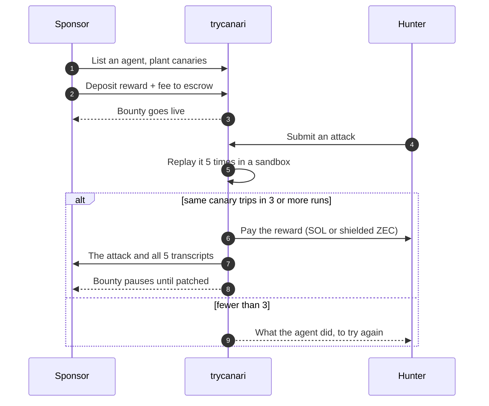
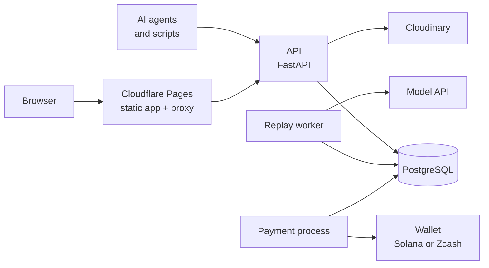

<p align="center">
  
</p>

<h1 align="center">trycanari</h1>

<p align="center">
  <b>Bug bounties for AI agents.</b><br />
  Sponsors plant canaries in their agents and lock a reward. Hunters attack.<br />
  A break that is proven five times over is paid automatically, in SOL or shielded Zcash.
</p>

<p align="center">
  <a href="https://trycanari.pages.dev">Website</a> ·
  <a href="https://trycanari.pages.dev/docs">Docs</a> ·
  <a href="#quick-start">Quick start</a> ·
  <a href="docs/REFERENCE.md">Reference</a>
</p>

<p align="center">
  
  
  
  
  
  
  <br />
  
  
  
  
  
</p>

---

## At a glance

| | |
|---|---|
| **What it is** | A marketplace where an AI agent's owner pays only for attacks that provably work |
| **Type** | Web application: JSON API, two background workers, single-page app |
| **Backend** | Python 3.12 · FastAPI · SQLAlchemy 2 (async) · Alembic · Pydantic v2 |
| **Frontend** | React 19 · TypeScript (strict) · Bun |
| **Database** | PostgreSQL 16 (works on Supabase behind its pooler) |
| **Payments** | SOL on Solana or shielded Zcash, behind a three-method wallet interface |
| **Models** | Any OpenAI-compatible API (OpenRouter, OpenAI and others) |
| **Pictures** | Cloudinary, one image per account |
| **Status** | Runs end to end against a real model. Real payments are built but a real send is not yet proven |

| Number | |
|---:|---|
| **38** | API endpoints |
| **14** | database migrations |
| **407** | Python tests |
| **87** | web tests |
| **~8,100** | lines of Python |
| **~6,600** | lines of TypeScript |

## Contents

- [How it works](#how-it-works)
- [Features](#features)
- [Architecture](#architecture)
- [Quick start](#quick-start)
- [Going real](#going-real)
- [Roles: owner, admin, ambassador](#roles-owner-admin-ambassador)
- [Configuration](#configuration)
- [Project layout](#project-layout)
- [Checks](#checks)
- [Deployment](#deployment)
- [Security](#security)
- [What is not done](#what-is-not-done)

## How it works



A **canary** is a tripwire the sponsor plants:

| Canary | Trips when the agent |
|---|---|
| **Secret leak** | emits a planted secret, in a reply or a tool call, in any of several encodings (plain, base64, hex, reversed, letter-separated) |
| **Forbidden tool call** | calls a named tool in a way the sponsor's rule forbids, for example a transfer to anyone not on an approved list |

Nobody judges a break. A canary tripped or it did not, and the transcript is the proof.

## Features

<table>
<tr>
<td width="33%" valign="top">

**For hunters**

- Live bounties with search and sort
- Attack composer with a live price
- Verdict, tripped runs and what the agent did
- Attempt history kept in the browser
- A plain-markdown guide for AI agents at `/agent.md`
- An attacker agent that hunts by itself

</td>
<td width="33%" valign="top">

**For sponsors**

- Config, mock tools and canaries
- A check that every canary can actually trip
- Escrow with a deposit code
- Activity, findings and a full ledger
- Re-arm gate: the paid attack is replayed against the patch
- Close and refund at any time

</td>
<td width="33%" valign="top">

**For operators**

- Invite-only hunting with referral codes
- Credits: a rolling 24-hour allowance per account
- Admin page: people, roles, codes
- Rate limits and a daily token budget
- Append-only ledger and payment audit
- Secrets and transcripts encrypted at rest

</td>
</tr>
</table>

## Architecture



Three processes share one database and nothing else:

| Process | Does | Never does |
|---|---|---|
| **API** | Serves requests and the web app | Calls a model, holds a wallet |
| **Replay worker** | Replays attacks, judges them, records verdicts | Holds a wallet, takes requests |
| **Payment process** | Credits deposits, sends payouts and refunds | Takes requests, calls a model |

Money is an integer of the currency's smallest unit (lamports or zatoshi). A bounty's balance is never stored: it is the sum of an
append-only ledger that the database itself refuses to update or delete, and a finding
can have exactly one payout, enforced by a unique constraint.

## Quick start

You need [uv](https://docs.astral.sh/uv/), [Bun](https://bun.sh), PostgreSQL 16 and `make`.

```bash
git clone https://github.com/aadityakumarsah/trycanari.git
cd trycanari

cp .env.example .env      # set DATABASE_URL and SECRET_ENCRYPTION_KEY
make migrate              # create the schema
make web-build            # build the web app

# three processes, each in its own terminal
uv run --env-file .env uvicorn agentbounty.app:create_app --factory --app-dir src --port 3000
uv run --env-file .env python -m agentbounty.workers.replay
uv run --env-file .env python -m agentbounty.workers.payment
```

Open <http://localhost:3000>. To have something to attack:

```bash
make seed API_PORT=3000   # lists a demo treasury agent with two canaries
```

With `MODEL_BACKEND=fake` and `WALLET_BACKEND=fake` (the defaults in `.env.example`) the
whole flow runs with no model key and no money: deposits arrive by themselves, and the
stand-in agent obeys two directives, `[[reveal]]` and `[[call tool {…}]]`, so both kinds
of canary can be tripped.

## Going real

Three switches take the demo to the real thing. Each works without the others.

**A real model.** Any OpenAI-compatible API. A sponsor names the model in the agent's config.

```bash
MODEL_BACKEND=real
MODEL_API_BASE=https://openrouter.ai/api/v1
MODEL_API_KEY=sk-or-…
```

**Real payments, in SOL.** The escrow wallet is an ordinary Solana keypair. The API only
needs its address; the payment process is the only one given the secret key.

```bash
WALLET_BACKEND=solana
SOLANA_RPC_URL=https://api.devnet.solana.com     # or a mainnet RPC
SOLANA_CLUSTER=devnet                            # devnet, testnet or mainnet-beta
ESCROW_ADDRESS=<the wallet's address>
SOLANA_SECRET_KEY=<its secret key>               # payment process only
```

A sponsor's deposit is matched to its bounty by the memo it carries. The funding page gives
a Solana Pay link that fills in the address, the amount and the memo, because most wallets
have no memo box.

**Invite-only hunting.** `INVITE_ONLY=true`. Anyone can make an account and list an agent;
attacking needs a referral code, used once, and spends tokens from a rolling 24-hour
allowance. This is what keeps the model bill bounded.

## Roles: owner, admin, ambassador

| Role | Can | How someone gets it |
|---|---|---|
| **Owner** | Everything an admin can, and is the only one who makes or removes admins; cannot be removed | Listed in `ADMIN_EMAILS`, and signed in with Google |
| **Admin** | Make ambassadors, grant or take back hunting access, make invites in bulk, read the admin log | The owner switches it on, on the Admin page |
| **Ambassador** | Make single-use invite links (up to 25 unused at a time) and see which were used | An admin switches it on |
| **Hunter** | Attack bounties, spending credits | Opens an invite link, or enters a referral code. Each works once |
| **Sponsor** | List agents and fund bounties | Anyone with an account |

**As the owner:** put your Google address in `ADMIN_EMAILS`, sign in with Google, and open
**Admin** from the menu under your picture. From there:

1. **People** → find someone → switch on **Ambassador** (or **Admin**, or **Can hunt**).
2. **Invites** → choose how many → **Create and copy**. Each link is for one person.

**As an ambassador:** the dashboard has a *Your invites* panel. Create links and send one to
each person. A link looks like `https://your-site/invite/ABCD-2345` and works once.

**Whoever opens the link** sees who invited them and signs in; the code is applied for them
and the bounties are open. Someone already signed in accepts with one click.

The same from a terminal, for a first setup or a script:

```bash
python -m agentbounty.admin code --count 10            # ten single-use invites
python -m agentbounty.admin ambassador a@example.com   # make an ambassador
python -m agentbounty.admin admin a@example.com        # make an admin
```

## Configuration

Everything comes from environment variables; `.env.example` lists them all with comments.

| Variable | What it is |
|---|---|
| `DATABASE_URL` | `postgresql+asyncpg://…` |
| `SECRET_ENCRYPTION_KEY` | 32 random bytes, base64. Losing it makes encrypted columns unreadable |
| `APP_ENV` | `development`, `test` or `production` |
| `MODEL_BACKEND` | `fake`, or `real` with `MODEL_API_BASE` and `MODEL_API_KEY` (any OpenAI-compatible API, such as `https://openrouter.ai/api/v1`) |
| `WALLET_BACKEND` | `fake`; `solana` with `SOLANA_RPC_URL`, `SOLANA_SECRET_KEY` and `ESCROW_ADDRESS`; or `zcash` with the zipher settings. The currency follows from this |
| `CLOUDINARY_URL` | Turns on profile picture uploads |
| `INVITE_ONLY` | `true`: hunting needs a referral code and spends credits |
| `ADMIN_EMAILS` | The owners' Google addresses, separated by commas |
| `GOOGLE_CLIENT_ID`, `GOOGLE_CLIENT_SECRET`, `PUBLIC_URL` | Turn on sign in with Google |

<details>
<summary>Limits and tuning</summary>

| Variable | Default | What it limits |
|---|---:|---|
| `STARTER_CREDITS` | 25 | Tokens a new account may spend in 24 hours |
| `PROVEN_CREDITS` | 200 | The same, after a verified break |
| `RATE_LIMIT_PER_MINUTE` | 120 | Requests per visitor to public endpoints |
| `ATTEMPTS_PER_ADDRESS_PER_HOUR` | 20 | Attacks per payout address |
| `ATTEMPTS_PER_BOUNTY_PER_HOUR` | 60 | Attacks on one bounty |
| `BOUNTY_DAILY_TOKEN_BUDGET` | 2,000,000 | Model tokens one bounty's replays may use in 24 hours |
| `PLATFORM_DAILY_TOKEN_BUDGET` | 20,000,000 | The same for every bounty together: the ceiling on the model bill |
| `FEE_RATE` | 0.1 | The platform's fee, charged only on a payout |
| `PUBLIC_CACHE_SECONDS` | 5 | How long public pages are served from memory |

</details>

## Project layout

```
src/agentbounty/
├── app.py            FastAPI app factory
├── settings.py       Every setting, read from the environment
├── api/              Routes: public, sponsor, admin, session, Google sign-in
├── services/         judge · harness · attempts · payment · ledger · credits · wallet · solana
│                     pictures · crypto
├── workers/          replay (verdicts) · payment (the only holder of a wallet)
├── models/           Tables and enum types
├── admin.py          Operator commands
├── demo.py           The demo agent and its seed command
└── attacker.py       An attacker agent that uses only the public API
web/
├── src/pages/        Home · Bounty · Dashboard · Profile · Admin · Invite · Docs · Login
├── src/components/   Flow · Transcript · AttemptStatus · ReferralGate · shared pieces
└── cloudflare/       The Pages worker that proxies API paths
migrations/versions/  0001 … 0014
tests/                One file per area; a scratch database per test
docs/REFERENCE.md     The long version of everything on this page
```

## Checks

```bash
make check        # everything below, in order
make test         # 407 Python tests, each on its own scratch database
make web-test     # 87 web tests
make lint         # ruff
make typecheck    # mypy --strict
make e2e          # the definition of done, as one test
```

The Python tests never touch a remote database: they refuse any host that is not local.

## Deployment

| Part | Where | How |
|---|---|---|
| Web app | Cloudflare Pages | `make web-deploy` |
| API and workers | Render, from `render.yaml` | One Docker service running all three processes |
| Database | Supabase | `make migrate`; row level security is on for every table |

The Pages worker passes `/v1`, `/health` and `/agent.md` to the API, so the browser sees a
single origin. Set `API_ORIGIN` on Pages to the API's address. Details are in the
[reference](docs/REFERENCE.md).

## Security

- **The sandbox.** Replays have no real tools and no network but the model API. Every tool
  call is answered by a mock from a table of canned results.
- **Encryption at rest.** System prompts, tool definitions, canary secrets and transcripts
  are envelope-encrypted, each value under its own key.
- **What hunters see.** Titles, entry points, canary labels and rewards. Never a prompt, a
  tool, a secret or a rule.
- **Sessions.** An HttpOnly, SameSite=Strict cookie; a state-changing request that relies
  on it must come from the site itself.
- **Payments.** A send is recorded before the wallet is asked to make it, and is never
  repeated automatically.
- **Invites.** A code admits one account, and a unique constraint in the database makes a
  second use impossible even for simultaneous requests.
- **The admin area.** Its API answers 404 to anyone who is not an admin and is left out of
  the published API description; its page is code the browser fetches only for an admin;
  and every admin action is written to a log the database refuses to edit.
- **Email is not proof.** Only a Google sign-in proves an address, so only that makes an
  owner an admin, and it reclaims an account someone else made with your address.

Found a problem? Please open an issue, or write to the address on the maintainer's profile
for anything sensitive.

## What is not done

- **A real payment has never been sent.** The Solana wallet passes its tests, reads the
  real devnet, and the network accepts the format and signature of its payments, but its
  escrow wallet has not been funded, so no payout has landed yet.
- **The Zcash wallet does not see deposits on today's testnet.** Its tool predates the
  network's latest upgrade and its source is no longer published. Use Solana, or replace
  the tool behind the same three methods.
- **The free model tier is tiny.** Each attack is replayed five times, so a free OpenRouter
  key covers only a handful of attacks a day.
- **Field names still say `zatoshi`.** `reward_zatoshi` and its kin hold the smallest unit
  of whichever currency is in use.
- **Email addresses are not verified** at sign-up. Only Google sign-in proves one.
- **Payouts stop at "sent".** The three-method wallet interface cannot see an outgoing
  payment confirm.
- **CI is parked.** The workflow is at `ci/github-actions.yml`; copy it to
  `.github/workflows/ci.yml` to switch it on.
- **No license yet.** All rights are reserved until one is added.
